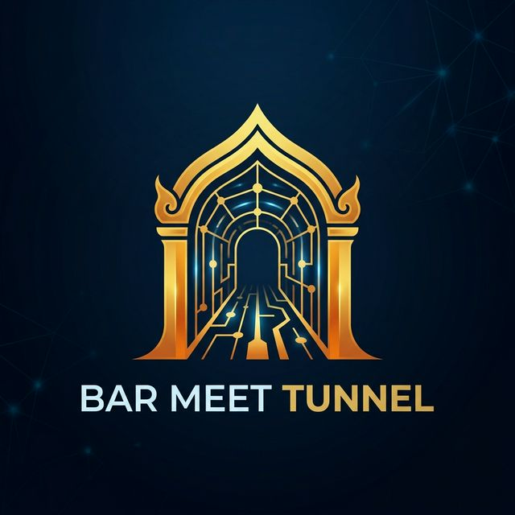
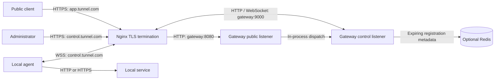

<p align="center">
  
</p>

# 🚀 Bar Meet Tunnel

An **Ngrok-style HTTP tunnel** built in Go, with authenticated agent connections, an embedded traffic inspector, and optional request replay.

[](https://go.dev/)
[](LICENSE)

## ✨ Features

- **HTTP tunneling:** Expose a local HTTP service through a public gateway.
- **Authenticated control plane:** Administrator access for the inspector/API and separate agent tokens for each allowed subdomain.
- **Traffic inspection:** Metadata-only capture by default, configurable header redaction, and automatic expiry.
- **Optional replay:** Enable full capture to retain original requests and replay them against an active tunnel.
- **Bounded resources:** Per-IP rate limits, per-tunnel concurrency limits, and a traffic-history byte budget.
- **Deployment options:** Run Go binaries directly or use the Docker stack with Nginx TLS termination and optional Redis metadata.

## 🏗️ Architecture

The Docker deployment routes public and control traffic through Nginx:



Both listeners belong to one gateway process. Live sessions and traffic history stay in memory. Redis does **not** provide durable traffic storage, session recovery, or routing between gateway replicas; run one gateway instance.

**Nginx is optional for local development.** The gateway serves HTTP and WebSocket connections directly, but does not currently provide native HTTPS/WSS. Remote control and agent access needs a TLS-terminating reverse proxy.

## 🚦 Local quick start

Use Go **1.26.8 or newer**, OpenSSL for token generation, and Python 3 for the example service. Go can download the required toolchain automatically when automatic toolchain selection is enabled and network access is available.

### 1. Start a local service

Run this from a directory whose files you intend to serve:

```bash
python3 -m http.server 8080 --bind 127.0.0.1
```

### 2. Start the gateway

In another terminal, from the repository root:

```bash
export CONTROL_TOKEN="$(openssl rand -hex 32)"
export AGENT_TOKEN="$(openssl rand -hex 32)"
export AGENT_TOKENS="{\"my-awesome-app\":\"$AGENT_TOKEN\"}"
export PUBLIC_ADDR="127.0.0.1:8081"
export CONTROL_ADDR="127.0.0.1:9000"

go run ./gateway
```

Keep both generated token values available for the agent and inspector. Redis is optional; if it is unavailable at startup, the gateway continues with its in-memory registry. The example uses port 8081 to avoid privileged ports and the local service on port 8080.

### 3. Start the agent

In another terminal, use the exact agent token generated above:

```bash
export AGENT_TOKEN="<your-generated-agent-token>"
export AGENT_ID="my-local-agent"
export SUBDOMAIN="my-awesome-app"
export LOCAL_HOST="http://127.0.0.1:8080"
export GATEWAY_WS="ws://127.0.0.1:9000/agent/connect"

go run ./agent
```

### 4. Send traffic and open the inspector

```bash
curl -H 'Host: my-awesome-app.tunnel.com' http://127.0.0.1:8081/
```

Open [http://127.0.0.1:9000/ui](http://127.0.0.1:9000/ui). Use username `admin` and the generated `CONTROL_TOKEN` as the password. Metadata is captured by default; bodies and replay require full capture.

## 📦 Docker deployment

The stack includes the gateway, Redis, and Nginx. Only Nginx publishes host ports **80 and 443**; HTTP requests redirect to HTTPS.

1. Copy the environment template and replace both placeholder tokens with independent values generated using `openssl rand -hex 32`:

   ```bash
   cp .env.example .env
   ```

2. Replace `tunnel.com` in [nginx/nginx.conf](nginx/nginx.conf) with your domain. Configure DNS for your tunnel subdomains and `control.<your-domain>`. Reserve the `control` subdomain for the control plane.
3. Provide certificates covering those names at `certs/fullchain.pem` and `certs/privkey.pem`. Certificate issuance and renewal are managed outside this application.
4. Validate and start the stack:

   ```bash
   docker compose config --quiet
   docker compose up --build -d
   ```

For the example domain, configure remote agents with:

```bash
export AGENT_TOKEN="<token-for-this-subdomain-from-AGENT_TOKENS>"
export SUBDOMAIN="my-awesome-app"
export LOCAL_HOST="http://127.0.0.1:8080"
export GATEWAY_WS="wss://control.tunnel.com/agent/connect"
go run ./agent
```

Open `https://control.tunnel.com/ui` for administration and `https://my-awesome-app.tunnel.com/` for public traffic.

The gateway runs as UID/GID **65532** in a read-only `scratch` container, with all Linux capabilities dropped, no new privileges, and a 128-process limit. Its public listener uses internal port **8080**; control uses **9000**. The runtime contains only the executable and CA certificates.

The Go builder, slim Nginx, and Redis images are pinned by digest. The build-context allowlist in [.dockerignore](.dockerignore) excludes `.env`, certificates, Git history, and unrelated files. Nginx has the fixed address `172.30.0.2`, trusted as `172.30.0.2/32`. If the Docker subnet conflicts with your network, update both the network configuration and `TRUSTED_PROXY_CIDRS` in [docker-compose.yml](docker-compose.yml).

### Using another reverse proxy

Route public hostnames to the gateway’s public listener and the control hostname to its control listener. For control connections, the proxy must support WebSocket upgrades, preserve the `Host` and `Authorization` headers, and set `X-Forwarded-Proto: https` after terminating TLS. Replace untrusted client forwarding headers with values derived from the connection.

Configure `TRUSTED_PROXY_CIDRS` with only the proxy’s source addresses. Restrict direct network access to the gateway control listener. Remote plaintext control requests are rejected; setting `CONTROL_ADDR=:9000` alone does not enable remote HTTP access.

## 🔧 Configuration

### Gateway

These defaults apply to the standalone binary. The Docker image uses `PUBLIC_ADDR=:8080`; Compose additionally sets `CONTROL_ADDR=:9000`, Redis, and the trusted proxy address.

| Variable | Default | Description |
| :--- | :--- | :--- |
| `PUBLIC_ADDR` | `:80` | Public HTTP listen address. Use an unprivileged port for a non-root standalone process. |
| `CONTROL_ADDR` | `127.0.0.1:9000` | Agent connection, inspector, and API listen address. |
| `CONTROL_TOKEN` | Required | Administrator password/API bearer token; at least 32 characters. |
| `AGENT_TOKENS` | Required | JSON object mapping allowed subdomains to tokens, each at least 32 characters. |
| `REDIS_URL` | `localhost:6379` | Optional Redis **host:port**, not a `redis://` URL. |
| `TRUSTED_PROXY_CIDRS` | Empty | Comma-separated proxy CIDRs trusted for client IP and HTTPS forwarding assertions. |
| `REQUEST_TIMEOUT_SECONDS` | `60` | Gateway request and body-read timeout setting, from 1 to 300 seconds. |
| `CAPTURE_MODE` | `metadata` | `off`, `metadata`, or `full`; see the capture modes below. |
| `CAPTURE_TTL` | `15m` | Retention duration, from `1s` to `24h`. |
| `REDACT_HEADERS` | Empty | Additional comma-separated header names to redact from stored metadata and inspector responses. |

For example, two allowed tunnels can be configured as:

```bash
export AGENT_TOKENS='{"app":"<random-token-at-least-32-characters>","api":"<different-random-token-at-least-32-characters>"}'
```

The Go binaries read process environment variables; they do not automatically load `.env`. Compose reads `.env` and passes the configured values into the gateway container. Restart the gateway to apply configuration or token changes.

### Agent

| Variable | Default | Description |
| :--- | :--- | :--- |
| `AGENT_TOKEN` | Required | Token assigned to the selected subdomain; at least 32 characters. |
| `AGENT_ID` | `hostname-pid` | Identifier that must be unique among active sessions. |
| `SUBDOMAIN` | `bar-meet-app` | Must match a key in the gateway’s `AGENT_TOKENS`. |
| `LOCAL_HOST` | `http://localhost:8080` | Absolute HTTP(S) URL of the local service. |
| `GATEWAY_WS` | `ws://localhost:9000/agent/connect` | Gateway connection URL; remote connections require `wss://`. |
| `REQUEST_TIMEOUT_SECONDS` | `60` | Local HTTP request timeout, from 1 to 300 seconds; align with the gateway. |

Plaintext agent connections are permitted only to loopback IPs or `localhost`, which is dialed directly as `127.0.0.1`. Private LAN addresses also require WSS.

## 👁️ Capture, redaction, and replay

| Mode | Retained traffic | Replay |
| :--- | :--- | :--- |
| `off` | No traffic records | Disabled |
| `metadata` — default | Request metadata and redacted headers; body data and the query-string field are omitted | Disabled |
| `full` | Original headers, query strings, and request/response bodies | Enabled while the record is retained and its tunnel is active |

To enable full capture for local debugging, set these before starting the gateway:

```bash
export CAPTURE_MODE=full
export CAPTURE_TTL=5m
export REDACT_HEADERS="X-Auth-Token,X-Session-Token"
```

For Compose, set the same values in `.env` and rerun `docker compose up -d`.

Authorization, proxy authorization, cookies, `Set-Cookie`, and `X-API-Key` headers are always redacted in inspector responses. `REDACT_HEADERS` extends that list. In metadata mode, those headers are redacted before storage. Full mode retains the originals for replay, even though inspector output is redacted.

The inspector is an administrator interface with access to **all tunnels**. Full capture can retain credentials and sensitive bodies; replay can repeat side effects. Metadata such as paths, other headers, and error messages can also contain sensitive information. Use `CAPTURE_MODE=off` when traffic must not be retained.

Records expire after `CAPTURE_TTL`, checked on access and every second while idle. History is also capped at 250 records and a 64 MiB payload/header budget; eviction or gateway restart removes replay availability.

## 📡 Control plane API

Inspector/API routes require authentication. Browsers use HTTP Basic authentication; scripts can use the administrator bearer token:

```bash
curl -H "Authorization: Bearer $CONTROL_TOKEN" \
  http://127.0.0.1:9000/api/tunnels
```

| Endpoint | Method | Description |
| :--- | :--- | :--- |
| `/ui` | `GET` | Embedded administrator inspector. |
| `/api/tunnels` | `GET` | Active tunnel sessions and statistics. |
| `/api/requests` | `GET` | Retained traffic; filter with `?tunnel=subdomain`. |
| `/api/requests/:id` | `GET` | Record details and body previews permitted by the capture mode. |
| `/api/requests/:id/replay` | `POST` | Replay a full-capture record against its active tunnel. |
| `/agent/connect?subdomain=<name>` | WebSocket upgrade | Agent connection authenticated with that subdomain’s bearer token; the agent supplies the query parameter automatically. |
| `/healthz` | `GET` | Unauthenticated liveness check; does not verify Redis or agent readiness. |

An active subdomain or agent ID cannot be replaced by a new connection. Disconnect the existing agent before reconnecting with conflicting identifiers. Cross-origin browser replay requests are rejected.

## 🔒 Forwarded headers

| Header | Value passed to the local service |
| :--- | :--- |
| `X-Forwarded-For` | Direct client IP, or the client IP determined through configured trusted proxies. |
| `X-Forwarded-Host` | Original public `Host` value. |
| `X-Tunnel-Subdomain` | Agent’s configured subdomain. |
| `X-Bar-Meet-Replay-Of` | Original record ID on a replay request. |

The agent sends the local service’s host as the HTTP `Host`. Redirect responses and escaped paths are preserved. Standard hop-by-hop headers and headers nominated by `Connection` are removed.

## 📝 Limits and supported behavior

| Limit | Behavior |
| :--- | :--- |
| Request/response body | Maximum 10 MiB each; bodies are buffered. |
| Gateway concurrency | 32 requests/replays across all tunnels. |
| Tunnel concurrency | 8 requests, with admission before reading request bodies. |
| Public per-IP concurrency | 4 active request handlers. |
| Per-IP rate | Burst of 60 requests, refilling at 5 requests/second. Public and control traffic use separate buckets; `/healthz` is exempt. |
| Limiter state | Maximum 4096 buckets; inactive buckets idle for 10 minutes can be reclaimed when capacity is needed. Clients behind one NAT share limits. |
| History | 250 records, 64 MiB payload/header budget, and configured TTL; excludes Go object overhead and in-flight buffers. |
| Inspector body preview | First 8 KiB per body in full mode, rendered as text or base64. |
| Shutdown | SIGINT/SIGTERM close agent sessions and initiate HTTP shutdown with a 15-second budget. |

Rate/concurrency rejection returns `429` for per-IP limits or `503` for gateway/tunnel capacity. Oversized public request bodies return `413`; gateway dispatch timeouts return `504`; upstream failures generally return `502`. Client cancellation and gateway timeout are forwarded to the agent to cancel local work.

Streaming/SSE, application WebSocket upgrades, durable history, and multi-gateway routing are not supported. The agent’s WebSocket connection is the transport for buffered HTTP requests; it does not enable WebSocket tunneling for the local application.

## 🔄 Upgrading an existing installation

- Rebuild **both gateway and agent** with Go 1.26.8 or newer. Authentication and cancellation protocol changes require matching updated binaries.
- Configure `CONTROL_TOKEN`, `AGENT_TOKENS`, and each agent’s `AGENT_TOKEN` before starting.
- Use WSS for remote agents and the TLS control hostname for administration. The standalone control listener defaults to loopback.
- Enable `CAPTURE_MODE=full` explicitly if body inspection and replay are needed; metadata-only capture is now the default.
- In Docker, route public traffic to `gateway:8080`. Ports 9000 and 6379 are no longer published to the host.
- Build packages rather than individual source files, because gateway functionality spans multiple Go files:

  ```bash
  mkdir -p bin
  go build -o bin/gateway ./gateway
  go build -o bin/agent ./agent
  ```

Changing the toolchain or image pin does not patch an already-built or running executable. Rebuild and restart the affected services.

## ✅ Validation and maintenance

```bash
go test -race ./...
go vet ./...
go run golang.org/x/vuln/cmd/govulncheck@v1.8.0 ./...
docker compose --env-file .env.example config --quiet
```

Integration tests open ephemeral loopback ports. Coverage includes authentication, TLS enforcement, capture modes/expiry, custom redaction, rate limits, admission before body reads, duplicate sessions, forwarding, replay, disconnect cleanup, redirects, cancellation, and escaped paths.

[GitHub Actions](.github/workflows/ci.yml) runs race tests, vet, vulnerability scanning, and formatting checks. [Dependabot](.github/dependabot.yml) is configured for weekly Go module, Docker, Compose, and GitHub Actions updates. Refresh image digests and rescan dependencies regularly; a successful scan is a snapshot, not a permanent security guarantee.

Compose configuration validation does not start containers or validate certificates. Test the full stack with Docker Engine running before deploying.

## 📜 License

[MIT](LICENSE).
